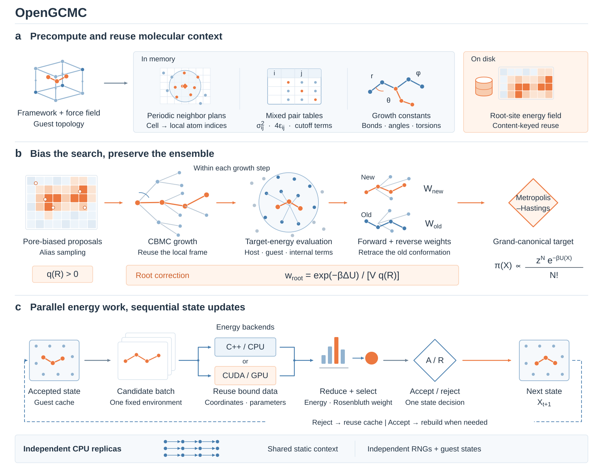
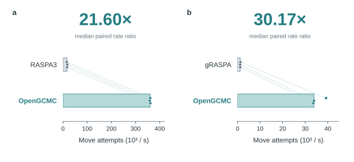

# OpenGCMC

**Cache-first grand canonical Monte Carlo for porous materials and flexible guests.**

[简体中文](README.md) · **English** · [日本語](README.ja.md)

OpenGCMC moves repeated neighbour searches, parameter mixing and environment construction out of trial evaluation. It combines exact energy evaluation with configurational-bias Monte Carlo (CBMC) for flexible molecules, through a native C++ sampler, a general Python interface and an optional CUDA energy backend.

### Thermodynamics and electrochemistry

- **Chemical potential response and free energy.** Estimate response matrices from occupancy fluctuations and combine fixed bias windows with MBAR to map occupancy and electrode charge.
- **Electrolytes and constant potential.** Exchange salts by stoichiometry and solve for constrained Gaussian electrode charges. Explicit SPC/E water supports protonation, redox and proton-coupled electron transfer with a fixed molecular topology.
- **Calibration and current.** Estimate reaction state free energies from alchemical windows. Use supplied kinetic rates or diffusivities to calculate current in physical time, including chronoamperometry and cyclic voltammetry.

[Electrochemical models and usage](docs/electrochemistry.md)

## Scientific case analyses

OpenGCMC has been exercised end to end on charged-MOF mixture adsorption, constant-potential electrolyte interfaces, explicit-water reaction free energies, and diffusion electrochemistry:

- **Competitive CO2/CH4 adsorption in charged IRMOF-1.** The case uses the CIF, site charges, and force field from the official RASPA3 example. Three independent OpenGCMC chains give 2.647 and 4.257 molecules per cell, compared with 2.615 and 4.246 for RASPA3, together with a chemical-potential response matrix and an MBAR free-energy landscape.
- **NaCl in SPC/E water at a constant-potential interface.** Two Gaussian electrodes, 62 explicit water molecules, and one ion pair are sampled in one workflow. Independent electrode-charge agreement is 1.1×10⁻¹⁵ e, full molecular-energy recomputation agrees to 1.95×10⁻⁷ K, and Na-O/Cl-O coordination is reported directly.
- **Ferricyanide/ferrocyanide diffusion electrochemistry.** Experimental diffusivities drive chronoamperometry and cyclic voltammetry. The maximum chronoamperometry difference from the Cottrell limit is 0.108%, and both scan rates agree with Randles-Sevcik peak-current predictions.
- **Explicit-water reactions and free-energy calibration.** Rigid SPC/E water, fixed-topology reaction states, NCMC, and seven-window MBAR compute reaction-state free-energy differences in one path with overlap and charge-response diagnostics.

The cases connect real crystal inputs, experimental parameters, or standard physical limits to reproducible numerical outputs across structure preparation, sampling, free energy, and current analysis. [Read the detailed case analyses](docs/scientific_cases.md).



## Performance

Same-system paired comparisons using a neutral Lennard–Jones probe in Cu-BTC give the following throughput gains for the cached native OpenGCMC sampler:

| Direct comparison | Median throughput gain | Range across three pairs | Workload |
|---|---:|---:|---|
| RASPA3 | **21.60×** | 20.06–23.27× | 40,000 production attempts after 10,000 warm-up attempts |
| gRASPA | **30.17×** | 28.34–30.25× | 1,000 attempts from an empty state; WSL, synchronized CUDA launches, shared GPU |



Each pair runs serially on the same system; the two comparisons are displayed separately. OpenGCMC uses its native CPU sampling loop; gRASPA uses its GPU sampling path. Gains are medians of paired throughput ratios. Initialization, preparation and final energy checks are outside the timed scope. The inputs match the 4,992-site framework, single-site probe, cutoff and potential conventions.

See the [benchmark protocol](docs/benchmarks.md) and [raw results](benchmarks/results) for individual timings, configuration-energy checks and reproduction commands.

## Core algorithms

- **Exact spatial and parameter caches.** Periodic fractional-cell bins and CSR candidate tables reuse neighbourhood geometry. Bound parameter rows reuse mixed interactions. Every query still evaluates actual distances and the exact cutoff.
- **Accepted-state environment reuse.** Rejected moves retain the guest environment; accepted moves trigger a lazy rebuild. Original-index exclusions remove the moved molecule without copying all remaining guests.
- **Density-corrected biased CBMC.** A frozen, full-support voxel alias distribution directs root-site proposals toward favourable regions. Both forward growth and retracing include `1 / [V q(r)]` to preserve the target distribution.
- **Batched trials and shared host data.** Energy requests with matching immutable environments and parameters are coalesced. Independent chains share the host cache while retaining separate guest states, random generators and acceptance decisions.
- **Exact target correction.** The Python route can screen proposals with a grid or learned surrogate and apply a two-stage acceptance rule for the exact target energy.

[Algorithm details and source map](docs/algorithms.md)

## Advances relative to RASPA and gRASPA

OpenGCMC combines reusable energy representations, flexible molecular growth and extensible energy interfaces. The direct RASPA3 comparison demonstrates higher production throughput for the stated probe workload, alongside explicit JSON inputs, a Python API and rigid-LJ input migration. Relative to gRASPA, OpenGCMC adds tree-flexible guest growth, retracing and regrowth, with a measured 30.17× attempt-rate gain under the listed short-run execution conditions.

| Workflow | OpenGCMC capabilities |
|---|---|
| Rigid and flexible guests | Rigid bodies, tree topologies, fixed or bounded bonds/angles, Fourier torsions, CBMC insertion/deletion/regrowth |
| Native fast sampling | Complete single-component C++ LJ/DSF loop with no Python calls inside the move loop |
| General sampling | Python multicomponent GCMC, Ewald electrostatics and optional exact target correction |
| GPU energy evaluation | Resident neighbourhood/parameter tables, reusable workspaces and NumPy/CuPy interfaces |
| Analysis and reuse | Number statistics, ESS, autocorrelation, checkpoints and independent chains sharing host data |
| RASPA3 migration | Explicit conversion of the rigid-LJ subset with inspectable physical quantities and units |

gRASPA focuses on GPU-parallel energy evaluation and rigid-body CBMC; the functionality comparison follows its [public source](https://github.com/snurr-group/gRASPA/tree/e6da4e376f19047df6cb85b9d20685d1bf0777e8). See the [detailed comparison](docs/algorithms.md#comparison-with-raspa3-and-graspa) for execution and input interfaces.

## Installation

Requires Python 3.10+ and a C++17 compiler.

```bash
git clone https://github.com/owenxyzhang-seseTJ/OpenGCMC.git
cd OpenGCMC
python -m venv .venv
source .venv/bin/activate
python -m pip install -e .
python native/build.py --portable --no-openmp
```

Omit `--no-openmp` when using an OpenMP-enabled compiler. The CUDA energy backend uses CUDA 12 and CuPy:

```bash
python -m pip install -e '.[cuda]'
```

The distribution and command are named `opengcmc`; the Python import namespace is `poremc`.

## Usage

```bash
# Native flexible-molecule sampling
opengcmc run examples/flexible_cached.json -o output/flexible

# Full-support root-site bias
opengcmc run examples/flexible_cached_bias.json -o output/biased

# Python sampler with the CUDA energy backend
opengcmc run examples/flexible_cuda.json -o output/cuda

# Grid proposals with exact target correction
opengcmc run examples/grid_delayed_acceptance.json -o output/corrected

# Constant-potential electrolyte GCMC
opengcmc-thermo run examples/thermodynamics/interface_constant_potential.json -o output/interface

# Explicit-water reaction sampling and cyclic voltammetry
opengcmc-reactive run examples/electrochemistry/hydrated_interface.json -o output/hydrated
opengcmc-reactive transport examples/electrochemistry/diffusion_voltammetry.json -o output/cv
```

Outputs include statistics, the input configuration, a checkpoint and final coordinates. Examples use explicit demonstration parameters. Specify the framework, guest, force field, charges, temperature and reservoir in JSON for a chosen system.

```python
from poremc.fast import FastGCMC
from poremc.engine import GCMC
from poremc.batching import evaluate_requests, run_native_replicas
```

## Repository contents

| Path | Contents |
|---|---|
| [`poremc/`](poremc) | Python API, CBMC, potentials, CUDA interfaces, statistics and I/O |
| [`native/`](native) | Exact C++17 energy kernels and the complete native sampling loop |
| [`examples/`](examples) | Adsorption, electrolytes, constant-potential interfaces, calibration and current |
| [`benchmarks/`](benchmarks) | Reproducible inputs, individual measurements and raw reference outputs |
| [`tools/`](tools) | Direct comparisons, numerical replay and data processing |
| [`figures/`](figures) | Editable plotting source, source data and captions |
| [`docs/`](docs) | [Technical report](docs/OpenGCMC_Technical_Report.pdf): mathematics, physics, algorithms and implementation (PDF, 36 pages) |
| [`tests/`](tests) | Numerical fixtures and algorithm tests |

## License and references

Released under the [MIT License](LICENSE). Algorithm references are collected in [`docs/references.bib`](docs/references.bib).

[RASPA3](https://github.com/iRASPA/RASPA3) · [gRASPA](https://github.com/snurr-group/gRASPA) · Figure style reference: [figures4papers](https://github.com/ChenLiu-1996/figures4papers)
