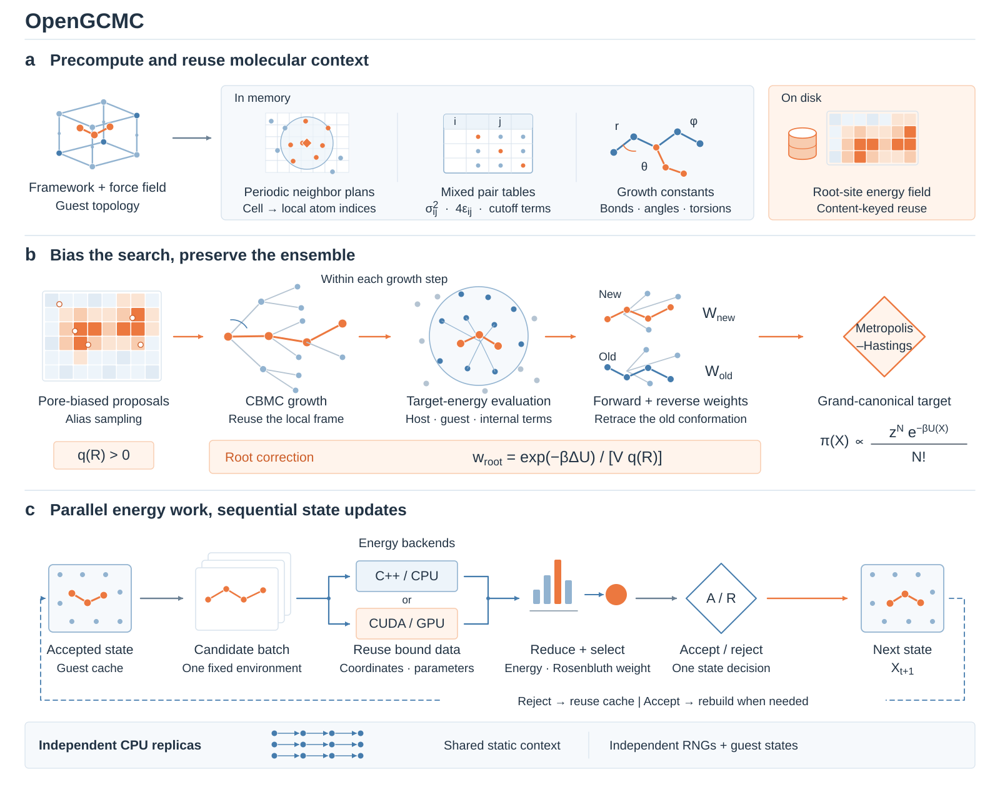
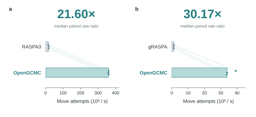

# OpenGCMC

**多孔性材料と柔軟なゲスト分子のための、キャッシュを中心に設計したグランドカノニカル Monte Carlo。**

[简体中文](README.md) · [English](README.en.md) · **日本語**

OpenGCMC は、繰り返し発生する近傍探索、相互作用パラメータの混合、環境の再構築を試行評価から切り離します。厳密なエネルギー評価と柔軟分子の配置バイアス Monte Carlo（CBMC）を組み合わせ、C++ ネイティブサンプラー、汎用 Python インターフェース、オプションの CUDA エネルギーバックエンドを提供します。

### 近日公開

現在、**化学ポテンシャル応答行列、自由エネルギーマップ、電解質のグランドカノニカルサンプリング、電気化学界面 GCMC**の開発を積極的に進めています。これらの機能は近日公開予定です。



## 性能

Cu-BTC 中の中性 Lennard–Jones プローブを用い、各ソフトウェアと同一システム上でペア比較した結果、キャッシュを用いる OpenGCMC ネイティブサンプラーは次のスループット向上を示しました。

| 直接比較 | 向上倍率の中央値 | 3 回のペア測定の範囲 | 計算条件 |
|---|---:|---:|---|
| RASPA3 | **21.60×** | 20.06–23.27× | 10,000 回の予備試行後、40,000 回の本計算試行 |
| gRASPA | **30.17×** | 28.34–30.25× | 空の初期状態から 1,000 回の試行；WSL、CUDA 同期起動、共有 GPU |



各比較は、それぞれの同一システム上で逐次実行し、別々に表示しています。OpenGCMC は CPU ネイティブサンプリング、gRASPA は GPU サンプリングを使用します。倍率はペアごとのスループット比の中央値です。初期化、準備、最終エネルギー照合は計時区間の外に置き、4,992 サイトの骨格、単一サイトプローブ、カットオフ、ポテンシャルの規約を揃えています。

各測定時間、配置エネルギーの照合、再現コマンドは[ベンチマーク文書](docs/benchmarks.md)と[生データ](benchmarks/results)に掲載しています。

## 中核アルゴリズム

- **厳密な空間・パラメータキャッシュ。** 周期的な分率座標のセル分割と CSR 候補表により近傍関係を再利用し、混合パラメータ行を事前に結び付けます。各問い合わせでは実距離と厳密なカットオフを評価します。
- **受理状態の環境再利用。** 棄却された移動ではゲスト環境を再利用し、受理後に必要に応じて再構築します。元のインデックスに基づく除外により、残りのゲスト全体をコピーせずに移動分子を除外します。
- **密度補正付きバイアス CBMC。** 全領域で正の確率を持つ固定 voxel alias 分布が、有利な領域へ根サイトを提案します。順方向の成長と逆方向の再追跡の両方に `1 / [V q(r)]` を含め、目標分布を保ちます。
- **試行の一括評価と骨格データの共有。** 同じ不変環境とパラメータを用いるエネルギー要求をまとめます。独立鎖は骨格キャッシュを共有し、ゲスト状態、乱数生成器、受理判定を個別に保持します。
- **厳密な目標分布への補正。** Python 経路では、グリッドまたは学習代理モデルで提案を選別し、二段階受理規則により厳密な目標エネルギーへ補正できます。

[アルゴリズムとソースコードの対応](docs/algorithms.md)

## RASPA・gRASPA に対する利点

OpenGCMC は、再利用可能なエネルギー表現、柔軟分子の成長、拡張可能なエネルギーインターフェースを統合します。RASPA3 との直接比較は、上記プローブ計算での本計算スループット向上を示しています。明示的な JSON 入力、Python API、剛体 LJ 入力の変換も提供します。gRASPA に対しては、木構造の柔軟ゲストの逐次成長、再追跡、再成長を備え、記載した短時間実行条件で試行スループットが 30.17× 向上しました。

| ワークフロー | OpenGCMC の機能 |
|---|---|
| 剛体・柔軟ゲスト | 剛体、木構造トポロジー、固定または有界の結合長・結合角、Fourier ねじれ項、CBMC 挿入・削除・再成長 |
| 高速ネイティブサンプリング | 単一成分 LJ/DSF の完全な C++ ループ。移動ループ内の Python 呼び出し不要 |
| 汎用サンプリング | Python 多成分 GCMC、Ewald 静電相互作用、オプションの厳密な目標補正 |
| GPU エネルギー評価 | 常駐する近傍・パラメータ表、再利用可能な作業領域、NumPy/CuPy インターフェース |
| 解析・再利用 | 粒子数統計、ESS、自己相関、チェックポイント、骨格データを共有する独立鎖 |
| RASPA3 入力変換 | 物理量と単位を確認できる剛体 LJ サブセットの明示的変換 |

gRASPA は GPU 並列エネルギー評価と剛体 CBMC を中心とする実装です。機能比較は[公開ソース](https://github.com/snurr-group/gRASPA/tree/e6da4e376f19047df6cb85b9d20685d1bf0777e8)に基づいています。実行構成と入力形式は[詳細比較](docs/algorithms.md#comparison-with-raspa3-and-graspa)を参照してください。

## インストール

Python 3.10 以降と C++17 対応コンパイラが必要です。

```bash
git clone https://github.com/owenxyzhang-seseTJ/OpenGCMC.git
cd OpenGCMC
python -m venv .venv
source .venv/bin/activate
python -m pip install -e .
python native/build.py --portable --no-openmp
```

OpenMP 対応コンパイラでは `--no-openmp` を省略できます。CUDA エネルギーバックエンドには CUDA 12 と CuPy を使用します。

```bash
python -m pip install -e '.[cuda]'
```

配布名とコマンド名は `opengcmc`、Python のインポート名は `poremc` です。

## 使用方法

```bash
# ネイティブの柔軟分子サンプリング
opengcmc run examples/flexible_cached.json -o output/flexible

# 全領域を覆う根サイトのバイアス提案
opengcmc run examples/flexible_cached_bias.json -o output/biased

# Python サンプラーと CUDA エネルギーバックエンド
opengcmc run examples/flexible_cuda.json -o output/cuda

# グリッド提案と厳密な目標補正
opengcmc run examples/grid_delayed_acceptance.json -o output/corrected
```

出力には統計、入力設定、チェックポイント、最終座標が含まれます。例では明示的なデモ用パラメータを使用しています。対象系に合わせて骨格、ゲスト、力場、電荷、温度、リザーバーを JSON で指定します。

```python
from poremc.fast import FastGCMC
from poremc.engine import GCMC
from poremc.batching import evaluate_requests, run_native_replicas
```

## リポジトリの内容

| パス | 内容 |
|---|---|
| [`poremc/`](poremc) | Python API、CBMC、ポテンシャル、CUDA、統計、入出力 |
| [`native/`](native) | 厳密な C++17 エネルギーカーネルとネイティブサンプリングループ |
| [`examples/`](examples) | キャッシュ、バイアス、CUDA、厳密補正の入力例 |
| [`benchmarks/`](benchmarks) | 再現用入力、各測定値、比較ソフトウェアの生出力 |
| [`tools/`](tools) | 直接比較、数値再生、データ処理ツール |
| [`figures/`](figures) | 編集可能な描画ソース、図の元データ、キャプション |
| [`tests/`](tests) | 数値 fixture とアルゴリズムテスト |

## ライセンス・参考資料

[MIT License](LICENSE) で公開しています。アルゴリズムの参考文献は [`docs/references.bib`](docs/references.bib) を参照してください。

[RASPA3](https://github.com/iRASPA/RASPA3) · [gRASPA](https://github.com/snurr-group/gRASPA) · 図のスタイル参考：[figures4papers](https://github.com/ChenLiu-1996/figures4papers)
