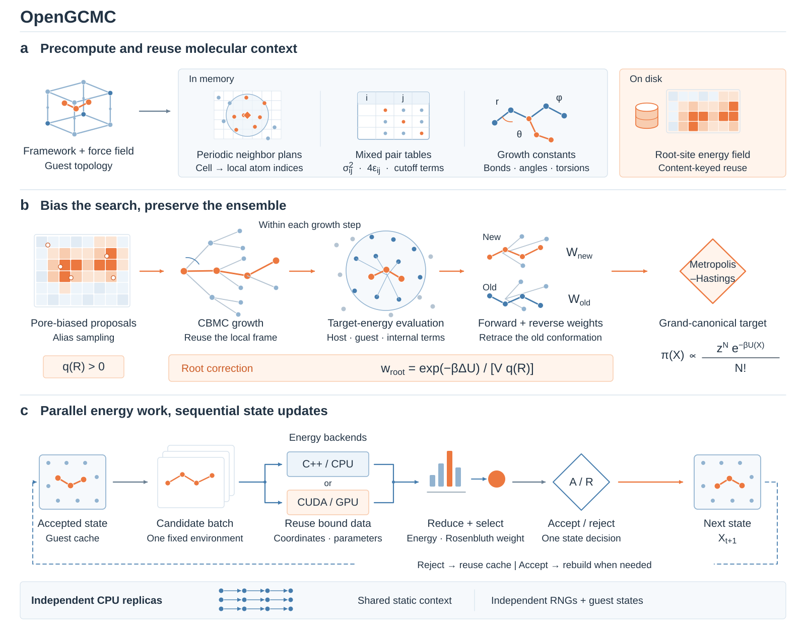
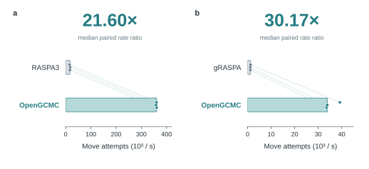

# OpenGCMC

**面向多孔材料与柔性客体的缓存优先巨正则 Monte Carlo。**

**简体中文** · [English](README.en.md) · [日本語](README.ja.md)

OpenGCMC 把重复的邻域搜索、参数混合和环境构建移出试探循环，将精确能量计算与柔性分子构象偏置采样（CBMC）结合。项目提供 C++ 原生采样器、Python 通用采样接口，以及可选的 CUDA 能量后端。

### 热力学与电化学

- **化学势响应与自由能图谱。** 从占据涨落得到响应矩阵，用 MBAR 合并固定偏置窗口，构建占据数和电极电荷的自由能分布。
- **电解质与恒电势界面。** 以化学计量交换盐，求解约束下的 Gaussian 电极电荷。显式 SPC/E 水支持固定拓扑的质子化、氧化还原和质子耦合电子转移。
- **校准与电流。** 通过炼金变换的窗口采样估计反应态间的自由能差，以给定的速率或扩散参数计算物理时间内的电流、计时安培曲线和循环伏安曲线。

[电化学模型与用法](docs/electrochemistry.md)

## 实际科研案例

OpenGCMC 已贯通带电 MOF 混合吸附、恒电势电解质界面、显式水反应自由能和扩散电化学四类科研任务：

- **带电 IRMOF-1 的 CO₂/CH₄ 竞争吸附。** 使用 RASPA3 官方示例的晶体、位点电荷和力场；三条独立链得到 2.647 与 4.257 个分子/晶胞，RASPA3 为 2.615 与 4.246，并同时生成化学势响应矩阵和 MBAR 自由能图谱。
- **NaCl/SPC/E 恒电势界面。** 62 个显式水分子和一对离子在两块 Gaussian 电极间采样；电极电荷独立核对误差为 1.1×10⁻¹⁵ e，分子能量全量重算误差为 1.95×10⁻⁷ K，并直接输出 Na–O、Cl–O 配位结构。
- **铁氰化物/亚铁氰化物扩散电化学。** 使用实验扩散系数计算计时安培和循环伏安；计时安培与 Cottrell 极限的最大电流差为 0.108%，两档扫描的峰电流与 Randles–Ševčík 结果一致。
- **显式水反应与自由能校准。** 刚体 SPC/E 水、固定拓扑反应态、NCMC 与七窗口 MBAR 在同一流程中计算反应态间的自由能差，并输出窗口重叠和电荷响应诊断。

这些案例把真实晶体、实验参数或标准物理极限接到可复现的数值输出，覆盖从结构输入、采样、自由能到电流分析的完整链路。[阅读详细案例分析](docs/scientific_cases.md)



## 性能

在同机配对的 Cu-BTC 中性 Lennard–Jones 探针算例中，OpenGCMC 的缓存原生采样循环取得以下吞吐提升：

| 直接比较 | 吞吐提升中位数 | 三次配对测量范围 | 工作量 |
|---|---:|---:|---|
| RASPA3 | **21.60×** | 20.06–23.27× | 每次 40,000 次生产尝试，预热 10,000 次 |
| gRASPA | **30.17×** | 28.34–30.25× | 每次 1,000 次尝试，空初态；WSL 同步 CUDA 启动、共享 GPU |



两组对照各自在同一系统上串行执行，分别展示。OpenGCMC 使用 CPU 原生采样循环；gRASPA 使用其 GPU 采样路径。倍数为每次配对吞吐比的中位数，初始化、准备和最终能量核对位于计时之外。基准采用相同的 4,992 位点框架、单原子探针、截断与势能约定。

完整协议、逐次耗时、能量核对和复现命令见[基准文档](docs/benchmarks.md)及[原始结果](benchmarks/results)。

## 核心算法

- **精确空间与参数缓存。** 周期性分数坐标分箱与 CSR 候选表复用邻域关系；混合参数行提前绑定。每次查询仍计算实际距离并应用精确截断。
- **接受态环境复用。** 被拒绝的移动继续复用客体环境；接受后按需重建。移动分子按原始索引排除，避免反复复制其余客体。
- **带密度校正的偏置 CBMC。** 冻结的全支持体素 alias 分布将根位点引向有利区域；正向生长与反向回溯均纳入 `1 / [V q(r)]`，保持目标分布。
- **试探合批与独立链共享。** 相同不可变环境和参数的能量请求合批；多条链共享框架缓存，各自保有客体状态、随机数与接受决策。
- **精确目标校正。** Python 路径可使用网格或学习代理进行提议筛选，再通过两阶段接受规则校正到精确目标能量。

[算法说明与源码映射](docs/algorithms.md)

## 相对 RASPA 与 gRASPA 的价值

OpenGCMC 将缓存、柔性构象生长和可扩展能量接口组织在同一工作流中。相对 RASPA3，直接对照展示了上述探针任务的生产吞吐提升，并提供显式 JSON 输入、Python API 和刚体 LJ 输入迁移。相对 gRASPA，OpenGCMC 提供树状柔性客体的逐段生长、回溯与再生长，并在所列短程执行条件下取得 30.17× 的尝试吞吐提升。

| 工作流 | OpenGCMC 提供的内容 |
|---|---|
| 刚体与柔性客体 | 刚体、树状柔性拓扑、固定或有界键长/键角、Fourier 扭转项、CBMC 插入/删除/再生长 |
| 原生快速采样 | C++ 完整单组分 LJ/DSF 循环，采样循环内无需 Python 调用 |
| 通用采样 | Python 多组分 GCMC、Ewald 静电、可选精确目标校正 |
| GPU 能量计算 | 常驻邻域与参数表、复用工作空间、NumPy/CuPy 接口 |
| 分析与复用 | 粒子数统计、ESS、自相关、检查点、独立链与共享框架缓存 |
| RASPA3 输入迁移 | 显式转换刚体 LJ 子集，保留可检查的物理量与单位 |

gRASPA 的实现重点是 GPU 并行能量计算和刚体 CBMC；功能对照依据其[公开源码](https://github.com/snurr-group/gRASPA/tree/e6da4e376f19047df6cb85b9d20685d1bf0777e8)。两者的执行组织与输入接口见[详细对照](docs/algorithms.md#comparison-with-raspa3-and-graspa)。

## 安装

需要 Python 3.10+ 和支持 C++17 的编译器。

```bash
git clone https://github.com/owenxyzhang-seseTJ/OpenGCMC.git
cd OpenGCMC
python -m venv .venv
source .venv/bin/activate
python -m pip install -e .
python native/build.py --portable --no-openmp
```

支持 OpenMP 的编译器可省去 `--no-openmp`。CUDA 能量后端使用 CUDA 12 与 CuPy：

```bash
python -m pip install -e '.[cuda]'
```

安装名与命令名为 `opengcmc`，Python 导入名为 `poremc`。

## 使用

```bash
# 原生柔性分子采样
opengcmc run examples/flexible_cached.json -o output/flexible

# 全支持根位点偏置
opengcmc run examples/flexible_cached_bias.json -o output/biased

# Python 采样与 CUDA 能量后端
opengcmc run examples/flexible_cuda.json -o output/cuda

# 网格提议与精确目标校正
opengcmc run examples/grid_delayed_acceptance.json -o output/corrected

# 恒电势电解质 GCMC
opengcmc-thermo run examples/thermodynamics/interface_constant_potential.json -o output/interface

# 显式水反应态采样与循环伏安
opengcmc-reactive run examples/electrochemistry/hydrated_interface.json -o output/hydrated
opengcmc-reactive transport examples/electrochemistry/diffusion_voltammetry.json -o output/cv
```

输出包含统计结果、输入副本、检查点及最终构型。示例使用显式给定的演示参数；实际体系在 JSON 中指定框架、客体、力场、电荷、温度与储库。

```python
from poremc.fast import FastGCMC
from poremc.engine import GCMC
from poremc.batching import evaluate_requests, run_native_replicas
```

## 仓库内容

| 路径 | 内容 |
|---|---|
| [`poremc/`](poremc) | Python API、CBMC、势能、CUDA 接口、统计与输入输出 |
| [`native/`](native) | C++17 精确能量内核与完整原生采样循环 |
| [`examples/`](examples) | 吸附、电解质、恒电势界面、反应校准与电流输入 |
| [`benchmarks/`](benchmarks) | 可复现输入、逐次测量与上游原始输出 |
| [`tools/`](tools) | 性能对照、数值回放和数据整理工具 |
| [`figures/`](figures) | 绘图源码、源数据及图注 |
| [`docs/`](docs) | [技术报告](docs/OpenGCMC_Technical_Report.pdf)：数学基础、物理模型、算法与实现（PDF，36 页） |
| [`tests/`](tests) | 数值 fixture 与算法测试 |

## 协议与参考

项目采用 [MIT License](LICENSE)。算法参考文献见 [`docs/references.bib`](docs/references.bib)。

[RASPA3](https://github.com/iRASPA/RASPA3) · [gRASPA](https://github.com/snurr-group/gRASPA) · 图形风格参考 [figures4papers](https://github.com/ChenLiu-1996/figures4papers)
