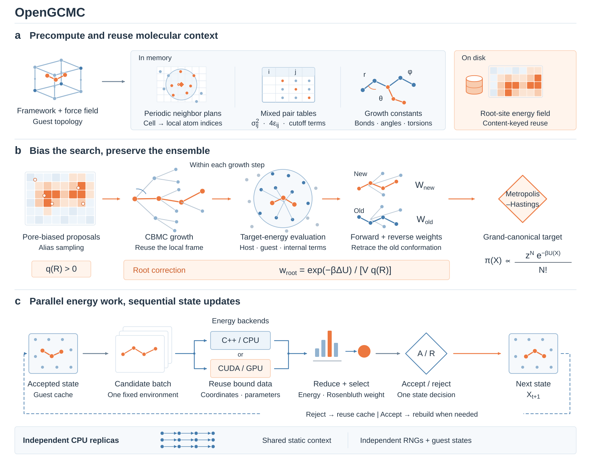

# Algorithms and execution structure

OpenGCMC reduces repeated work at three levels: fixed host geometry, repeated trial parameters, and the accepted guest state. These representations support exact cutoff energy evaluation, flexible configurational-bias growth and independent sampling chains.

## Exact geometry and parameter reuse

[`native/kernels.cpp`](../native/kernels.cpp) stores periodic host coordinates in fractional-cell bins. CSR-style offsets and candidate indices identify the sites that can contribute to a query. The candidate list is conservative: the kernel computes the actual periodic separation and applies the requested cutoff for every candidate. The cached representation therefore changes the work required to evaluate the potential, rather than replacing the potential with an interpolated field.

Bound query rows store mixed Lennard–Jones parameters, cutoff shifts and charge products for repeated query-site types. The implementation uses bounded-memory fallback paths when expanding all neighbour or parameter rows would exceed the cache budget. Original site indices survive sorting, so exclusions refer to physical sites rather than an incidental cache order.

## Accepted-state guest cache

In [`native/fast_mc.cpp`](../native/fast_mc.cpp), `cached_environment()` constructs a guest environment for the current accepted configuration. `external()` excludes the selected molecule through its original index range. Forward trials and retracing use the same remaining environment.

Rejected moves preserve this environment. Accepted insertion, deletion, translation, rotation or regrowth marks it dirty; the next energy query rebuilds it. This avoids constructing a new environment for every rejected trial while keeping the environment consistent with committed coordinates.

## Full-support root proposals and CBMC

[`poremc/proposals.py`](../poremc/proposals.py) constructs a frozen voxel proposal. A positive uniform mixture gives every voxel nonzero probability, and an alias table samples voxels in constant time. Positions are uniform within the selected voxel.

With volume \(V\), proposal density \(q(\mathbf r)\), temperature \(T\), and energies expressed as \(u=U/k_B\), a root trial uses

\[
w(\mathbf r)=\frac{\exp[-\Delta u(\mathbf r)/T]}{Vq(\mathbf r)}.
\]

The same density factor appears in forward growth and reverse retracing. The native sampler fixes the root proposal before production. Uniform proposals recover \(Vq=1\). For a multisite molecule, the root-site map directs proposals; the trial energy and CBMC weights account for the molecule's actual interactions.

The [`Python CBMC implementation`](../poremc/cbmc.py) handles rigid guests and tree-flexible growth, including partial suffix regrowth. The native implementation handles rigid guests, tree-flexible growth and full regrowth with fixed or bounded bond lengths and angles, and Fourier torsional terms. Internal-coordinate reference measures and activities are explicit in [`topology.py`](../poremc/topology.py).

## Batch energy requests and independent chains

[`evaluate_requests()`](../poremc/batching.py) groups energy queries with identical environment identity, atom count and site parameters. Returned energies preserve request order. Each chain subsequently makes its own acceptance decision.

`run_native_replicas()` shares the immutable host representation between native chains. Each chain owns its guest cache, random generator, particle state and counters. Sharing host data therefore saves repeated preparation without sharing a mutable Markov state.

## Exact correction after surrogate proposals

The Python [`GCMC`](../poremc/engine.py) engine can use a grid or learned host surrogate for proposals, then correct against a specified exact target. With surrogate \(\tilde u\) and exact energy \(u\), the second-stage energy factor is

\[
\alpha_2=\min\{1,\exp[-(\Delta u-\Delta\tilde u)/T]\}.
\]

The first stage includes the proposal and reservoir terms. Forward and reverse proposal construction and the second-stage correction work together to target the chosen exact potential. [`accelerators.py`](../poremc/accelerators.py) implements the surrogate fields.

## Execution routes

| Route | Sampling scope | Energy evaluation |
|---|---|---|
| [`FastGCMC`](../poremc/fast.py) / native C++ | One classical component; insertion, deletion, translation, rotation and full regrowth | LJ, DSF, direct Ewald and PME. Optional fixed-host grid and exact target correction. |
| [`GCMC`](../poremc/engine.py) / Python | Mixtures, flexible CBMC, partial regrowth and optional delayed acceptance | Classical LJ/DSF/Ewald and extensible potential interfaces |
| [`CudaEnvironment`](../poremc/cuda.py) | Called by the Python sampling/energy layer | Resident neighbour plans, mixed-parameter bindings and reusable FP64 workspaces |

The diagram illustrates short-range cache reuse. The external throughput comparisons use the native CPU sampling loop. Direct Ewald, PME, fixed-host reference grids and the native CUDA reciprocal plug-in are described in [Native long-range sampling](long_range.md).

## Comparison with RASPA3 and gRASPA

| Aspect | OpenGCMC | RASPA3 | gRASPA |
|---|---|---|---|
| Main organization | Cached C++ sampler, Python general sampler and optional CUDA energy layer | General molecular Monte Carlo and adsorption workflows | GPU-parallel molecular Monte Carlo and adsorption workflows |
| Inputs used here | Explicit JSON/Python and native C ABI | `simulation.json`, force-field and molecule JSON, CIF | `simulation.input`, `.def` files and CIF |
| Flexible guest route | Tree growth/retracing/regrowth; fixed or bounded bonds/angles | CBMC and molecular force-field infrastructure | The inspected molecule reader accepts rigid definitions and rejects flexible definitions |
| Reuse emphasized by this project | Exact CSR candidates, mixed-parameter bindings, accepted-state guest environments and shared host data | Direct reference run uses its conventional swap path | Direct reference run uses its stock one-trial swap path |
| Measured result | [21.60× versus RASPA3 and 30.17× versus gRASPA](benchmarks.md) under their respective retained protocols | 40,000 production attempts per repeat | 1,000 scheduled attempts per repeat under WSL synchronous launch conditions |

The gRASPA functionality statement follows its pinned [molecule reader](https://github.com/snurr-group/gRASPA/blob/e6da4e376f19047df6cb85b9d20685d1bf0777e8/src_clean/read_data.cpp), which raises `Currently Not allowing flexible molecule` for the flexible-definition branch. gRASPA also provides mixtures, TMMC, fractional-component and machine-learning workflows; the comparison above focuses on the cache and flexible-growth organization relevant to OpenGCMC.

The measured ratios quantify the complete retained sampling paths. They do not isolate a speed contribution for an individual cache, alias proposal or CUDA kernel. The optional algorithm branches in the architecture are capabilities; conventional K = 1 insertion/deletion is used in the external throughput comparisons.

## References

Algorithm references are collected in [BibTeX format](references.bib). Upstream projects: [RASPA3](https://github.com/iRASPA/RASPA3), [gRASPA](https://github.com/snurr-group/gRASPA).
