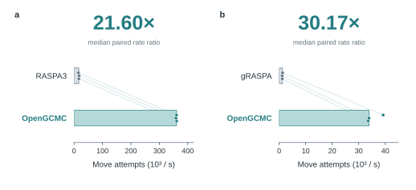

# Direct performance comparisons

[CPU time-to-precision benchmarks](../benchmarks/cpu/README.md) report four-chain measurements for charged and flexible adsorption, matched RASPA3 CBMC runs, and independent NIST distribution checks.

The retained measurements compare the cached native OpenGCMC sampler directly with RASPA3 and gRASPA. Each pair runs serially on the same system. The RASPA3 and gRASPA experiments use separate systems and protocols; their absolute rates appear on separate axes.



Bars show median attempt throughput; points show all three timing repeats. The highlighted gains are medians of the three **paired** throughput ratios, rather than ratios of the two median bars. Figure source data and captions are in [`figures/`](../figures).

## Shared interaction model

| Quantity | Setting |
|---|---|
| Framework geometry | Controlled P1 Cu-BTC geometry; 624 sites per unit cell, replicated 2 × 2 × 2 to 4,992 sites |
| Cell | Orthogonal, 52.686 Å per side |
| Guest | Neutral single-site LJ probe; σ = 3 Å, ε/kB = 5 K |
| Interactions | Shifted Lennard–Jones, Lorentz–Berthelot mixing, cutoff 12 Å, no tail corrections |
| Temperature | Nominally 300 K; RASPA3's numerical unit constants are matched in its paired native run |
| Reservoir | Activity 3/V = 2.051330191901013 × 10⁻⁵ Å⁻³; pressure 84,965.09082237349 Pa |
| Moves | Equal insertion/deletion selection probabilities; one trial per insertion, K = 1 |
| Native path | Production C ABI via [`tools/native_benchmark.py`](../tools/native_benchmark.py); one CPU thread |
| Seeds | 927001, 928001, 929001; matching seed labels identify pairs, not identical random trajectories |

The probe parameters define a controlled computational workload. Retained CIFs and all force-field inputs are under [`benchmarks/inputs/`](../benchmarks/inputs).

## RASPA3 production comparison

RASPA3 3.1.0 and OpenGCMC start empty. Each uses 10,000 warm-up attempts followed by **40,000 actual production attempts**. In this low-loading setup, RASPA3's 500 initialization cycles and 2,000 production cycles each contain 20 attempts. The analyzer verifies actual move counters and checks that the CBMC swap counter is zero. The input key is `SwapConventionalProbability`.

The RASPA3 production timer and OpenGCMC native production-loop timer exclude initialization, input preparation and final energy recomputation. RASPA3 retains its standard property statistics; OpenGCMC records molecule counts every 20 attempts.

| Seed | RASPA3 production (s) | OpenGCMC production (s) | Paired rate ratio |
|---:|---:|---:|---:|
| 927001 | 2.393013 | 0.110809708 | 21.595698× |
| 928001 | 2.238938 | 0.111622333 | 20.058154× |
| 929001 | 2.581463 | 0.110930459 | 23.271003× |

**Median: 21.595698×; observed range: 20.058154–23.271003×.**

The final reference configurations were recomputed with OpenGCMC's direct reference energy evaluator. All three checks passed, including two nonempty configurations; the maximum absolute difference was **2.2737367544323206 × 10⁻¹³ K**. OpenGCMC's own final running energies were also checked against direct recomputation outside timing.

- [Paired results](../benchmarks/results/raspa3_comparison.json)
- [Reference logs and configurations](../benchmarks/results/raspa3_raw)
- [Inputs](../benchmarks/inputs/cubtc)
- [Analyzer](../tools/analyze_raspa3_comparison.py)

## gRASPA short-run comparison

The stock gRASPA executable and OpenGCMC start empty, with no warm-up, and execute **1,000 scheduled insertion/deletion attempts** per repeat. `UseMaxStep yes`, `MaxStepPerCycle 1` and 1,000 production cycles define this workload. Trial positions and orientations are both set to one.

The gRASPA `Work took` timer starts after preparation and ends before final energy checks. With initialization and equilibration cycles both zero, it measures the retained production phase including stock statistics. OpenGCMC records molecule counts every 20 attempts inside its native timer.

| Seed | gRASPA sampling (s) | OpenGCMC sampling (s) | Paired rate ratio |
|---:|---:|---:|---:|
| 927001 | 0.844800 | 0.029808438 | 28.340968× |
| 928001 | 0.893087 | 0.029523914 | 30.249614× |
| 929001 | 0.769737 | 0.025511510 | 30.172146× |

**Median: 30.172146×; observed range: 28.340968–30.249614×.**

Execution conditions for this result:

- WSL runtime with `CUDA_LAUNCH_BLOCKING=1`, as used by the installed launcher.
- An existing, unrelated workload remained on the shared GPU; recorded temperatures were 81–82 °C. Device snapshots are retained with the raw records.
- OpenGCMC uses its CPU native sampler; gRASPA uses its stock GPU path. The reported number describes this short-run attempt-throughput comparison under these execution conditions.
- The installed upstream source is pinned to [`e6da4e376f19047df6cb85b9d20685d1bf0777e8`](https://github.com/snurr-group/gRASPA/tree/e6da4e376f19047df6cb85b9d20685d1bf0777e8). Its first-position random-number diagnostic is preserved, including the initial out-of-cell coordinate in one retained snapshot; periodic energy evaluation is used.

gRASPA's reported `Insertion Performed` and `Deletion Performed` counters omit empty-deletion self-transitions. Their sum is therefore smaller than the number of scheduled attempts. The figure and analyzer use **1,000 scheduled attempts**, rather than this performed-move sum.

The sparse `PrintEvery` setting saves a restart at **production cycle 0**. Energy validation uses that configuration and its matching cycle-0 logged energy, rather than the final-stage energy. The maximum difference is **2.3176815489023284 × 10⁻⁷ K**, consistent with the retained log/coordinate precision. One reference snapshot is nonempty. OpenGCMC's final running energy is independently recomputed for every repeat.

These measurements report attempt throughput. They do not provide a cross-engine equilibrium ESS ratio or long-run convergence comparison.

- [Paired results](../benchmarks/results/graspa_comparison.json)
- [Reference logs, device snapshots and configurations](../benchmarks/results/graspa_raw)
- [Inputs](../benchmarks/inputs/graspa)
- [Analyzer](../tools/analyze_graspa_comparison.py)

## Reproduction

Install OpenGCMC and its native library as described in the README. Supply locally installed reference executables. The runners create a new directory and preserve each input and log; existing run directories are never overwritten.

```bash
python tools/run_raspa3_comparison.py \
  --executable /path/to/raspa3 \
  --directory benchmarks/runs/raspa3

python tools/run_graspa_comparison.py \
  --executable /path/to/graspa \
  --directory benchmarks/runs/graspa \
  --max-temperature 87
```

The gRASPA runner uses synchronized CUDA launches, records device conditions and bounds each reference repeat to 1,000 attempts. Running the analyzers executes the paired OpenGCMC sampling loop on the same local system. Fresh timings reflect the local runtime and load; retained timings remain separate.

Regenerate the two figures from the committed measurements without running either simulator:

```bash
python -m pip install -e '.[report]'
python figures/plot_figures.py
```

## Additional algorithm measurements

The repository includes measurements of individual computational mechanisms. These use their own tasks and denominators:

| Measurement | Retained result | Data |
|---|---:|---|
| 64 matched energy requests, batched versus separate calls | 4.00× | [Batching](../benchmarks/results/batching_benchmark.json) |
| Four independent chains, parallel versus sequential execution | 3.24× median | [Independent chains](../benchmarks/results/parallel_benchmark.json) |
| Analytic voxel-well task, biased versus uniform root proposals | 38.21× median ESS/s | [Seed 37](../benchmarks/results/search_37.json), [43](../benchmarks/results/search_43.json), [59](../benchmarks/results/search_59.json) |
| CUDA cached versus direct energy call, retained 32,000-site case | 23.67× | [Paired CUDA records](../benchmarks/gpu_20261117/results.json) |

The last row compares two OpenGCMC energy algorithms and is separate from the gRASPA comparison. The voxel-well ESS/s result is specific to that analytic sampling task.

## Charged p-xylene in Ni_TPT_TATBA

This single-core HPC benchmark uses a fixed 2 × 2 × 2 framework supercell with 4,416 sites, a charged 12-site p-xylene model and the full finite direct Ewald target with `kmax=[13, 13, 13]`. Insertion, deletion, translation, rotation and full CBMC regrowth are enabled. Each mode uses three seeds. The delayed paths load the prebuilt reference grid before production. The table reports the median number of attempted moves per second for the harmonic CPU implementation.

| Loading and run length | Mode | Median production attempts/s | Mean guest count per supercell |
|---|---|---:|---:|
| Low, 5,000 attempts after 500 warm-up | Exact | 286.32 | 4.33 |
| Low, 5,000 attempts after 500 warm-up | Delayed, 32³ | 6,412.00 | 3.57 |
| Low, 5,000 attempts after 500 warm-up | Delayed, 64³ | 6,564.00 | 4.35 |
| Higher, 3,000 attempts after 300 warm-up | Delayed, 32³ | 1,678.72 | 29.55 |
| Higher, 3,000 attempts after 300 warm-up | Delayed, 64³ | 1,535.84 | 32.04 |

These short runs have different observed loadings across modes. The rates describe the stated inputs and measure computational throughput. Equilibrium uptake, mixing and effective sample size require separate analysis. The study's framework and force field are required to repeat these particular timings. The source includes [illustrative Ewald inputs and benchmark commands](long_range.md#reproduction-and-source).

A cache audit at 64³ used 128 moves per condition with a common seed. Framework preparation took 19.27 s with the file cache off, 18.37 s on a cold write and 0.24 s on a warm read. The cache file occupies 9,437,416 bytes. Direct comparisons found identical recorded counts, sampled energies, move counters and end coordinates across the three conditions. These preparation times are separate from the throughput table.

- [Low-loading seed records](../benchmarks/results/nit_tpt_pxylene/low_loading.json)
- [Higher-loading seed records](../benchmarks/results/nit_tpt_pxylene/higher_loading.json)
- [Framework cache audit](../benchmarks/results/nit_tpt_pxylene/host_grid_cache.json)

CUDA compile/link and CPU test-plug-in checks for the reciprocal tensor path are recorded separately. [Compile record](../benchmarks/results/longrange/tensor_build_validation.json) · [Host numerical check](../benchmarks/results/longrange/tensor_host_validation.json)
